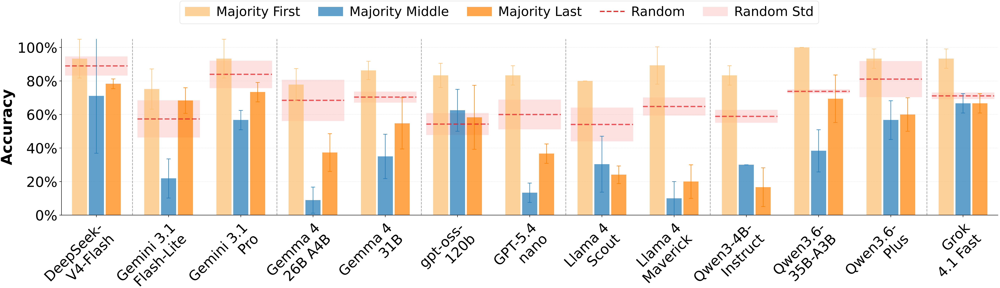

# Does Every Instance Count Equally? Order Effects in LLM Multi-Instance Processing

<p align="center">
  <a href="https://arxiv.org/abs/2610.29057">
    
  </a>
  <a href="https://huggingface.co/datasets/jingxuanchen916/mip-order">
    
  </a>
</p>

In multi-instance processing (MIP), an LLM processes many individual inputs and combines their results into a single answer. This dataset contains prompts with 100 to 2,000 instances across five binary classification tasks, where models must identify the majority label. By presenting the same instances in different orders, we find that simply rearranging inputs can dramatically change model accuracy, even though the correct answer stays the same.

<p align="center">
  
</p>

## Data

```python
from datasets import load_dataset

core = load_dataset("jingxuanchen916/mip-order", "core", split="test")
generalisability = load_dataset("jingxuanchen916/mip-order", "generalisability", split="test")
```

The [dataset card](https://huggingface.co/datasets/jingxuanchen916/mip-order) describes the tasks,
the orders and the columns.

## Evaluate a model

```bash
pip install -r requirements.txt
export OPENROUTER_API_KEY=...   # sent only to OpenRouter; another endpoint reads API_KEY
python run.py --model meta-llama/llama-4-scout --setting core   # --base-url for e.g. a local vLLM server
python score.py results/core/*/*.jsonl --by task order_pattern
```

`run.py` writes one line per prompt to `results/<setting>/<prompt>/<model>.jsonl` and skips the
rows already there when re-run; `--setting generalisability` runs the other configuration, and
`--task` and `--limit` run a subset. The defaults follow the paper: temperature 0, at most 20,000
output tokens, and up to 3 attempts when no answer can be parsed. `--prompt` picks one of the
paper's prompting strategies in `prompts.yaml`: `standard` (default), `hint`,
`suggested_strategy`, or `self_prompt`, where the model first writes its own instruction.

## Our work on Multi-Instance Processing (MIP)

<table>
  <tr>
    <td><b>MIP-Understanding</b></td>
    <td><a href="https://aclanthology.org/2026.acl-long.1470/">Understanding LLM Performance Degradation in Multi-Instance Processing: The Roles of Instance Count and Context Length</a> (ACL 2026)</td>
    <td><a href="https://github.com/jingxuanchen916/mip-understanding">💻 Code</a></td>
    <td><a href="https://huggingface.co/datasets/jingxuanchen916/mip-understanding">🤗 Dataset</a></td>
  </tr>
  <tr>
    <td><b>MIP-Order</b></td>
    <td><a href="https://arxiv.org/abs/2610.29057">Does Every Instance Count Equally? Order Effects in LLM Multi-Instance Processing</a></td>
    <td><a href="https://github.com/jingxuanchen916/mip-order">💻 Code</a></td>
    <td><a href="https://huggingface.co/datasets/jingxuanchen916/mip-order">🤗 Dataset</a></td>
  </tr>
</table>

## Citation

```bibtex
@misc{chen2026doesinstancecountequally,
      title={Does Every Instance Count Equally? Order Effects in LLM Multi-Instance Processing}, 
      author={Jingxuan Chen and Mohammad Taher Pilehvar and Jose Camacho-Collados},
      year={2026},
      eprint={2610.29057},
      archivePrefix={arXiv},
      primaryClass={cs.AI},
      url={https://arxiv.org/abs/2610.29057}, 
}
```
